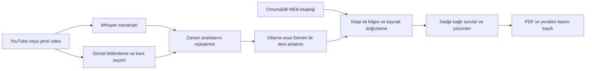

<p align="center">
  
</p>

# LectraAI

**Bu AI uygulaması, ders videolarından hızlıca görsel destekli ders notu çıkarmaya yarar.**

LectraAI, Türkçe ders videolarındaki konuşmayı ve ekrandaki öğretim materyallerini eşleştirerek PDF ders fasikülü hazırlar. Bir YouTube bağlantısındaki veya bilgisayarındaki videodan zaman damgalı bölümler, ekran görüntüleri, düzenlenmiş ders anlatımı ve isteğe bağlı bir değerlendirme bölümü oluşturabilirsin. MEB ders kitapları indekslendiğinde uygulama, ilgili açıklamaları ve doğrulanabilen sayfa atıflarını fasiküle ekler.

## Özellikler

| Özellik | Açıklama |
| --- | --- |
| Video girişi | YouTube bağlantısı veya sürükle-bırak ile MP4, MKV, MOV, WEBM ve AVI dosyaları |
| Ses tanıma | Faster-Whisper `large-v3-turbo` ile zaman damgalı Türkçe transkript ve tekrar kullanım için yerel transkript kaydı |
| Görsel bölümleme | OpenCV ile materyal değişimi tespiti, MediaPipe ile elin kapattığı kareleri ayıklama ve bölüm içinden okunabilir kare seçimi |
| Ders anlatımı | Seçilen sınıf düzeyine göre Ollama veya Gemini ile transkript düzeltme, düzenlenmiş anlatım ve önemli kavramlar |
| MEB kitaplığı | ChromaDB üzerinde sınıf filtreli arama, doğrulanabilen basılı sayfa atıfları ve arayüzde kitap araması |
| Değerlendirme | Çoktan seçmeli, doğru-yanlış ve boşluk doldurma soruları, gerekçeli cevap anahtarı ve uygun kitap kaynakları |
| PDF ve yeniden basım | Bölüm önizleme, PDF indirme ve kayıtlı içerikten modele yeniden istek göndermeden basım |
| Üretim kontrolü | Aşama bazlı ilerleme, işlem sırasında kilitlenen üretim düğmesi ve yerel üretimi durduran iptal düğmesi |

## Hızlı başlangıç

### 1. Sistem araçları

- **Python 3.13 (64 bit)** ile Windows üzerinde geliştirilip test edildi.
- **FFmpeg** video karelerinin çıkarılması için gerekir. FFmpeg’in `bin` klasörünü Windows `PATH` değişkenine ekle. [FFmpeg indirme sayfası](https://ffmpeg.org/download.html)
- **Ollama** yerel anlatım modelleri için gerekir. Ayrıca MEB kitaplığının 768 boyutlu vektörlerini aramak ve yeni kitapları indekslemek için `embeddinggemma` modeli Ollama üzerinden çalışır. Gemini’yi anlatım modeli olarak seçtiğinde de etkin MEB araması bu embedding servisini kullanır. [Ollama kurulumu](https://ollama.com/download)
- **Gemini API anahtarı** yalnızca Gemini ile içerik üretmek veya Ollama’dan Gemini’ye geçmek için gerekir. [Google AI Studio API anahtarları](https://aistudio.google.com/api-keys)
- YouTube indirmelerinde yt-dlp, video sağlayıcısının JavaScript kontrollerini çözmek için **Deno** gibi desteklenen bir çalışma ortamına ihtiyaç duyabilir. Yerel video yükleme bu indirme adımını atlar. [yt-dlp ve JavaScript çalışma ortamları](https://github.com/yt-dlp/yt-dlp/wiki/EJS)

FFmpeg’i kurduktan sonra PowerShell’de kontrol et.

```powershell
ffmpeg -version
```

### 2. Proje ve Python ortamı

```powershell
git clone https://github.com/muhammetkrktt12/AI-Video-Lesson-Analyzer.git LectraAI
Set-Location LectraAI
py -3.13 -m venv .venv
.\.venv\Scripts\python.exe -m pip install --upgrade pip
.\.venv\Scripts\python.exe -m pip install -r requirements.txt
```

### 3. Ollama modelleri

Ollama’yı aç ve kullanacağın modeli indir. `qwen3.5:4b` daha küçük bir yerel seçenek. `qwen3.5:9b` daha fazla bellek gerektirir. Kitap araması için `embeddinggemma` ayrı indirilir.

```powershell
ollama pull embeddinggemma
ollama pull qwen3.5:9b
# İsteğe bağlı ikinci anlatım modeli
ollama pull qwen3.5:4b
ollama list
```

Arayüz iki önerilen Qwen modelini gösterir. Ollama’ya erişilebiliyorsa kurulu olmayan önerilen modeller **yüklü değil** olarak işaretlenir. Yerel sunucuda kurulu diğer anlatım modelleri de listelenir.

### 4. Ortam değişkenleri

Proje kökünde `.env` dosyası oluştur. Yalnızca Ollama ile çalışacaksan `GEMINI_API_KEY` satırını boş bırakabilirsin. Gemini kullanacaksan kendi anahtarını bu dosyaya ekle.

```dotenv
OLLAMA_BASE_URL=http://localhost:11434
OLLAMA_MODEL=qwen3.5:9b
EMBED_MODEL=embeddinggemma
GEMINI_API_KEY=
GEMINI_MODEL=gemini-3-flash-preview
GEMINI_REQUESTS_PER_MINUTE=4
```

| Ayar | Kullanım |
| --- | --- |
| `OLLAMA_BASE_URL` | Ollama servis adresi |
| `OLLAMA_MODEL` | Varsayılan yerel anlatım modeli |
| `EMBED_MODEL` | MEB kitaplığı için embedding modeli. Mevcut koleksiyonla uyumlu kalması için `embeddinggemma` kullan. |
| `GEMINI_API_KEY` | Gemini proje anahtarı |
| `GEMINI_MODEL` | Varsayılan Gemini anlatım modeli |
| `GEMINI_REQUESTS_PER_MINUTE` | Uygulamanın aynı modele yaptığı çağrılar arasındaki aralığı belirler. `4`, en az 15 saniye aralık bırakır. `0`, sabit aralığı kapatır. |
| `GEMINI_TIMEOUT`, `GEMINI_MAX_RETRIES`, `GEMINI_FALLBACK_MODELS` | Gemini’nin genel çağrı ayarları. Soru üretimi ve kaynak doğrulamasının kendi zaman aşımı ve yeniden deneme kuralları vardır. |
| `OLLAMA_SECTION_TIMEOUT`, `OLLAMA_QUESTION_TIMEOUT` | Yerel bölüm anlatımı ve soru çağrılarının saniye cinsinden bekleme süresi |
| `OLLAMA_SECTION_NUM_PREDICT`, `OLLAMA_QUESTION_NUM_PREDICT` | Yerel bölüm anlatımı ve soru üretimi için çıktı tokenı ayarları |

`GEMINI_REQUESTS_PER_MINUTE` değerini kendi projenin kota ekranına göre seç. Bu ayar günlük kotayı değiştirmez ve diğer uygulamaların aynı projeye gönderdiği istekleri yönetmez. [Gemini kota ekranı](https://aistudio.google.com/rate-limit)

### 5. MEB kitaplığını hazırla

Kitap PDF’leri ve ChromaDB veritabanı Git deposunun dışında tutulur. Bu nedenle yeni bir kurulumda MEB araması ve atıflar için PDF’leri `data/reference_books/` dizinine koyup indeksi oluşturman gerekir. Hazır indeksleyici şu dosya adlarını bekler.

```text
data/reference_books/
├── ilkokul_fenbilimleri_3.sinif_1.kitap.pdf
├── ilkokul_fenbilimleri_3.sinif_2.kitap.pdf
└── ilkokul_fenbilimleri_4.sinif.pdf
```

Önce salt okunur önizleme yap. Beklenen kitaplar ve 768 boyutlu embedding doğrulandıktan sonra yazma izniyle tekrar çalıştır.

```powershell
.\.venv\Scripts\python.exe .\index_ilkokul_books.py
.\.venv\Scripts\python.exe .\index_ilkokul_books.py --allow-write
```

Tek kitap eklemek için `--kitap DOSYA_ADI` kullan. `--reindex` verilen kitapların mevcut parçalarını silip yeniden oluşturur. Olağan ilk kurulumda `--allow-write` yeterlidir.

Etkin veritabanı `data/chroma_db/`, koleksiyon adı `eduframe_meb_768`. Hazır indeksleme betiği **3. ve 4. sınıf Fen Bilimleri** kitaplarını kapsar. Arayüzde daha fazla sınıf seçeneği bulunur. O sınıf için kitap verisi yoksa MEB atfı eklenmeyebilir.

### 6. Arayüzü başlat

```powershell
.\.venv\Scripts\python.exe -m streamlit run app.py
```

Tarayıcıda [localhost:8501](http://localhost:8501) adresini aç.

## Arayüz kullanımı

1. **Video kaynağı** alanında YouTube bağlantısı gir veya **Bilgisayardan** seçeneği ile video dosyanı bırak.
2. **Fasikül ayarları** bölümünde eğitim düzeyini, sınıfı ve anlatım modelini seç. Gemini menüsü, API anahtarının projesinde kullanılabilen izinli metin modellerini gösterir. Arayüzdeki liste Gemini 3 Flash, Gemini 3.8 Flash ve Gemini 3.5 Flash Lite ile sınırlıdır.
3. İstersen **Değerlendirme sorularını ve cevap anahtarını ekle** seçeneğini aç. Ollama ile yalnızca uygulamanın denetiminden geçen sorular basılır. Bu yüzden PDF’de ondan az soru olabilir.
4. **PDF oluştur** düğmesine bas. Video hazırlama, transkripsiyon ve kare seçimi, MEB araması, bölüm sentezi, soru üretimi ve PDF basımı aşamalarını ekranda takip edebilirsin.
5. Üretim sürerken yeni bir üretim başlatılamaz. **İşlemi iptal et** yerel üretim sürecini durdurur ve düğmeyi yeniden etkinleştirir. Gönderilmiş bir bulut isteğinin uzaktaki sunucuda durması garanti edilemez.
6. Ollama üretimi durursa arayüz **Gemini devreye girsin mi?** diye sorar. **Evet** Gemini ile devam eder. **Hayır** aynı Ollama modeliyle yeniden dener. Gemini’ye geçiş PDF arayüzünde kullanıcı kararına bağlıdır.
7. Sonuçtan bölümleri, ekran görüntülerini ve cevap anahtarını önizle. **PDF’yi indir** ile dosyayı al. **Kayıtlı içerikten yeniden bas** aynı ders içeriğini ve soruları tekrar kullanır. 1–5. sınıflarda yeniden basım için çerçeve seçilebilir.

**MEB kitaplığında ara** sekmesinden video üretmeden seçili eğitim düzeyine göre kitap metinlerini sorgulayabilirsin. Belirli bir sınıfın kitaplarında aramayı test etmek için terminalde `check_rag_quality.py --sinif` seçeneğini kullan.

## Terminal kullanımı

Yerel videodan Ollama veya Gemini ile değerlendirmeli PDF üretmek için aşağıdaki örneklerde video yolunu kendi dosyanla değiştir.

```powershell
.\.venv\Scripts\python.exe .\ders_pdf.py qwen3.5:9b "C:\Videolar\ders.mp4" "3. Sınıf" --soru-ekle
.\.venv\Scripts\python.exe .\ders_pdf.py gemini "C:\Videolar\ders.mp4" "3. Sınıf" --soru-ekle
```

Soru bölümü istemiyorsan `--soru-ekle` seçeneğini çıkar. Gemini modeli terminalde `GEMINI_MODEL` ile seçilir. Yukarıdaki **Evet/Hayır** penceresi Streamlit arayüzüne aittir. Yalnızca yerel terminal kullanımı istiyorsan o oturumda Gemini API anahtarı tanımlama.

`run.py`, YouTube bağlantısı veya yerel yol için varsayılan modelle çalışan alternatif komuttur. Bu komutta değerlendirme bölümü varsayılan olarak açıktır.

```powershell
.\.venv\Scripts\python.exe .\run.py "C:\Videolar\ders.mp4" --seviye "İlkokul" --soru-yok
```

### Modele bağlanmadan yeniden basım

```powershell
$icerik = Get-ChildItem .\temp_medya\outputs -Filter "*.icerik.json" |
    Sort-Object LastWriteTime -Descending | Select-Object -First 1
.\.venv\Scripts\python.exe .\ders_pdf.py --yeniden-bas $icerik.FullName
```

Bu komut için önce başarıyla oluşturulmuş bir fasikülün `.icerik.json` kaydı ve kaydın işaret ettiği ekran görüntüleri gerekir. Yeniden basım sırasında Gemini, Ollama ve Whisper çağrılmaz.

## Sistem nasıl çalışır?



- **Bölümler videoya göre belirlenir.** Görsel materyal değişimleri konuşma aralıklarıyla eşleştirilir. Kare seçiminde yazıların görünürlüğü ve el örtüşmesi gibi unsurlar değerlendirilir.
- **Her bölüm kendi konuşmasına dayanır.** Model, bölüm transkriptini işler. Ders anlatımı, transkript ve önemli kavramlar PDF’de ayrı alanlarda gösterilir. Yinelenen kavramlar belge çapında ayıklanır.
- **Kitap desteği ayrı tutulur.** Uygun eşleşme bulunduğunda MEB açıklaması ders anlatımının altında ayrı paragraf olarak yer alır. Video içindeki soru çözümü bölümlerine bu ek paragraf uygulanmaz.
- **Sorular ve kaynaklar denetlenir.** Ollama akışında model soruyu ilk cevabı görmeden çözmeye çalışır ve konuşmadan dayanak gösterir. Elenen sorular, kalan sorularla PDF üretimini durdurmaz. Kitap atıfları için alıntı kitap metninde doğrulanır ve sayfa numarası indeks kaydından alınır. Doğrulanamayan kaynaklar belirtilir.
- **Gemini kullanımı takip edilebilir.** Uygulama, API’nin döndürdüğü görünür çıktı, düşünme ve giriş tokenlarını üretim aşamasına göre kaydeder. API kullanım bilgisi döndürmediğinde kayıtta ölçülemediği gösterilir.

İlk Whisper çalıştırmasında model dosyalarının indirilmesi gerekebilir. Whisper, uyumlu NVIDIA ortamında CUDA’yı dener ve desteklenen çalışma zamanı hatalarında CPU moduna geçer. GPU hızlandırması için kullanılan CTranslate2 sürümüyle uyumlu cuBLAS ve cuDNN kitaplıklarını kur. [Faster-Whisper GPU bağımlılıkları](https://github.com/SYSTRAN/faster-whisper#gpu)

## Çıktılar ve proje yapısı

| Yol | İçerik |
| --- | --- |
| `app.py`, `.streamlit/config.toml` | Streamlit arayüzü ve tema |
| `core/eduframe_agentic_core.py`, `core/state.py` | LangGraph iş akışı ve durum şeması |
| `services/` | Video, transkript, RAG, model, değerlendirme ve PDF servisleri |
| `services/pdf_job.py` | Arayüz için iptal edilebilir PDF işi ve kısmi çıktıları ayrı tutan geçici iş dizini |
| `templates/prompts/` | Gemini ve Ollama için düzenlenebilir istemler. 4B ve 9B ders anlatımı istemleri ayrı dosyalardır. |
| `templates/cerceveler/` | İlk beş sınıfın PDF çerçeveleri. Yeni PDF üretiminde uygun çerçevelerden biri rastgele seçilir. |
| `data/reference_books/`, `data/chroma_db/` | Yerel kitap PDF’leri ve etkin arama indeksi |
| `temp_medya/outputs/` | `LectraAI_…pdf` dosyaları ve bunlara ait `.icerik.json` yeniden basım kayıtları |
| `temp_medya/frames/`, `temp_medya/videos/` | Bölüm kareleri ve hazırlanan videolar |
| `temp_medya/gemini_kullanim/` | Aşama ve model bazlı JSONL Gemini kullanım kayıtları |

Yeniden basımı daha sonra kullanacaksan PDF ile birlikte içerik kaydını ve kaydın kullandığı görselleri de sakla.

## Doğrulama ve sorun giderme

```powershell
.\.venv\Scripts\python.exe -m pip check
.\.venv\Scripts\python.exe -m unittest discover -s tests
.\.venv\Scripts\python.exe .\test_video_segmentation.py "C:\Videolar\ders.mp4"
.\.venv\Scripts\python.exe .\check_rag_quality.py
.\.venv\Scripts\python.exe .\check_rag_quality.py --sorgu "Elektrikli araç gereçlerin ortak özellikleri nelerdir?" --sinif "3. Sınıf" --max-mesafe 1.1
```

`00_kurulum_kontrol.py` ortamı, araçları ve servisleri kontrol eder. **Geçerli bir Gemini anahtarı tanımlıysa canlı API isteği de gönderir.** Yalnızca çevrimdışı paket kontrolü için `pip check` kullan.

| Belirti | Kontrol |
| --- | --- |
| FFmpeg bulunamadı | `ffmpeg -version` çıktısını kontrol et. PATH değiştiyse terminali yeniden aç. |
| Ollama modeli yüklü değil | Ollama’yı çalıştırıp `ollama list` ile modeli kontrol et. Eksik modeli `ollama pull` ile indir. |
| YouTube videosu indirilemiyor | yt-dlp ve FFmpeg sürümlerini, varsa YouTube için gerekli JavaScript çalışma ortamını kontrol et. Video dosyan varsa **Bilgisayardan** seçeneğini kullanabilirsin. |
| Gemini `429` dönüyor | API anahtarının bağlı olduğu projenin dakika ve gün sınırlarını kontrol et. Daha uzun HTTP zaman aşımı kotayı yükseltmez. |
| MEB araması boş | Kitap PDF’lerinin adlarını, etkin Chroma dizinini, `embeddinggemma` modelini ve seçilen sınıfı kontrol et. |
| Bir bölüm için temiz kare bulunamadı | `test_video_segmentation.py` ile görsel ve konuşma aralıklarına bak. PDF akışı görseli olmayan bir bölümü sessizce atlamaz. |
| Yeniden basımda görsel bulunamadı | `.icerik.json` içindeki kare yollarına erişilebildiğini kontrol et. |
